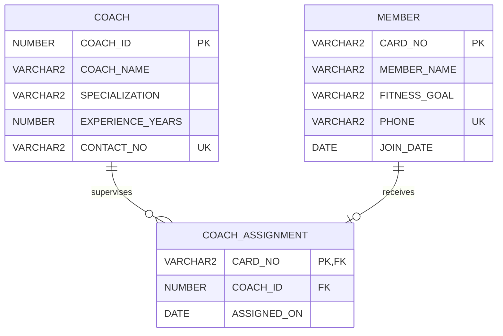

# GYM COACH MATCHING SYSTEM
## DBMS Full-Stack Project Report

**Submitted by:** Swastik Satyam  
**Registration No.:** 25BCB0039  
**Course context:** Database Management Systems

## 1. Abstract

The Gym Coach Matching System is a database-backed web application for coordinating fitness-centre members and certified coaches. It stores each member under a unique membership card number and records their fitness goal. Coaches are identified by an internal coach ID and name, with optional specialization, experience and contact details. The application supports member and coach CRUD, current coach assignment, reassignment, assignment removal, search/filtering and dashboard statistics. The browser uses HTML, CSS and JavaScript; an Express/Node.js REST API performs parameterized SQL against Oracle Database through the `oracledb` driver. The frontend never connects directly to Oracle.

## 2. Introduction

A gym must keep member profiles, fitness goals, instructors and current training matches accurate. Paper records and disconnected spreadsheets make it difficult to identify a member's coach, list a coach's members or track unassigned members. A relational database enforces identifiers and relationship integrity, while a web interface makes routine operations accessible.

## 3. Problem Statement

Design and implement a working Gym Coach Matching System in which every member has a unique card number and fitness goal, every coach has a unique internal ID and name, and one coach can be matched to multiple members. The system must support creation, viewing, editing, deletion, assignment management, searching and dashboard summaries using a real Oracle database.

## 4. Objectives

- Maintain reliable member and coach records.
- Create, reassign and remove current coach-member assignments.
- Preserve referential integrity with primary and foreign keys.
- Support searching and filtering.
- Show totals for members, coaches, assigned members and unassigned members.
- Demonstrate Oracle DDL, DML, joins, aggregation and subqueries through a full-stack application.

## 5. Existing System

Manual registers and separate spreadsheets can cause duplicate or stale records, inconsistent coach assignments and time-consuming manual counts. Deleting or updating a record may not be reflected everywhere, and referential integrity is not enforced automatically.

## 6. Proposed System

A responsive dashboard communicates with an Express API. The API validates requests, binds SQL parameters, executes statements using an Oracle connection pool and returns JSON. Oracle constraints remain the authoritative integrity layer. The interface renders database results and provides feedback when operations succeed or fail.

## 7. Functional Requirements

1. Create, read, update and delete member records.
2. Create, read, update and delete coach records, subject to assignment integrity.
3. Assign a coach to a member, reassign the member, and remove the assignment.
4. List assignments and members of a specific coach.
5. Search by card number, member name, fitness goal, coach name or coach ID.
6. Filter by fitness goal and coach.
7. Display total members, total coaches, assigned members and unassigned members.
8. Reject duplicate identifiers and invalid references with clear messages.

## 8. Non-Functional Requirements

- **Integrity:** Oracle PK/FK/UNIQUE/CHECK/NOT NULL constraints protect the stored data.
- **Security:** credentials are environment variables; SQL uses bind variables.
- **Maintainability:** routes, controllers, DB configuration and frontend files are separated.
- **Usability:** responsive layout, clear forms, status indicators and error messages.
- **Reliability:** connection pooling and centralized error handling.
- **Performance:** indexes support coach assignment and fitness-goal queries; pool supports concurrent requests.

## 9. Technology Stack

| Layer | Technology |
|---|---|
| Frontend | HTML5, CSS3, vanilla JavaScript |
| API/backend | Node.js, Express.js |
| Oracle driver | `oracledb` |
| Database | Oracle Database and Oracle SQL |
| Setup/testing | npm, Oracle SQL Developer, browser/curl |

## 10. System Architecture

```text
GYM COACH MATCHING SYSTEM
          |
          v
Frontend: HTML + CSS + JavaScript
          |  HTTP/JSON
          v
Express.js REST API (Node.js)
          |  oracledb connection pool + parameterized SQL
          v
Oracle Database
   |         |             |
 COACH     MEMBER    COACH_ASSIGNMENT
```

The frontend contains no database credentials and does not import or use `oracledb`. All reads and writes pass through the backend.

## 11. ER Diagram



### ER explanation

- **COACH** is an entity identified by `COACH_ID`. Its descriptive attributes are coach name, specialization, years of experience and contact number.
- **MEMBER** is an entity identified by `CARD_NO`. Its attributes include member name, fitness goal, optional phone and join date.
- **COACH_ASSIGNMENT** is the relationship entity for the current coach match. A coach may have zero or many assignment rows. A member may have zero or one assignment row.
- `COACH_ASSIGNMENT.CARD_NO` is both its primary key and a foreign key to `MEMBER`, which enforces at most one current coach per member. `COACH_ID` references `COACH` and is not unique, allowing one coach to serve multiple members.
- This model deliberately permits an unassigned member. Removing an assignment does not delete the member.

## 12. Relational Schema

- `COACH(**COACH_ID**, COACH_NAME, SPECIALIZATION, EXPERIENCE_YEARS, CONTACT_NO)`
  - Primary key: `COACH_ID`
  - Candidate key: `COACH_ID`; `CONTACT_NO` is an alternate candidate key when non-null, enforced unique by Oracle.
- `MEMBER(**CARD_NO**, MEMBER_NAME, FITNESS_GOAL, PHONE, JOIN_DATE)`
  - Primary key: `CARD_NO`
  - Candidate key: `CARD_NO`; non-null `PHONE` values are unique when supplied.
- `COACH_ASSIGNMENT(**CARD_NO**, COACH_ID, ASSIGNED_ON)`
  - Primary key: `CARD_NO`
  - Foreign keys: `CARD_NO → MEMBER(CARD_NO)`, `COACH_ID → COACH(COACH_ID)`
  - `CARD_NO` is the relationship key and guarantees no more than one current assignment per member. `COACH_ID` may repeat.

## 13. Functional Dependencies

For the declared relations:

- `COACH_ID → COACH_NAME, SPECIALIZATION, EXPERIENCE_YEARS, CONTACT_NO`
- `CARD_NO → MEMBER_NAME, FITNESS_GOAL, PHONE, JOIN_DATE`
- `CARD_NO → COACH_ID, ASSIGNED_ON` in `COACH_ASSIGNMENT`
- Because contact and phone are unique when populated, a non-null `COACH.CONTACT_NO` identifies a coach and a non-null `MEMBER.PHONE` identifies a member within their respective relations. Oracle permits multiple nulls in ordinary UNIQUE constraints.

## 14. Normalization

### First Normal Form (1NF)

Each column stores a single value; there are no repeating groups or lists in a field. Each table has a row identifier.

### Second Normal Form (2NF)

Every relation has a single-attribute primary key, so there can be no partial dependency on part of a composite key. Non-key attributes depend on the whole key.

### Third Normal Form (3NF)

In `COACH`, coach details depend on `COACH_ID`; in `MEMBER`, member details depend on `CARD_NO`; in `COACH_ASSIGNMENT`, coach ID and assignment date depend on the assignment key `CARD_NO`. Coach names and member names are not duplicated into the relationship table, so updates are made in one entity row.

### BCNF

For the stated functional dependencies, each non-trivial determinant is a candidate key: the three relations satisfy BCNF under the model's declared dependencies. Optional unique phone/contact values are alternate candidate keys when present.

### Anomalies reduced

- **Update anomaly:** changing a coach name or member goal is done in one entity row.
- **Insertion anomaly:** a coach can be registered before being assigned any members; a member can be registered before being assigned a coach.
- **Deletion anomaly:** deleting an assignment does not delete either entity. Deleting a member removes its assignment by `ON DELETE CASCADE`. A coach with current assignments cannot be deleted until those assignments are changed or removed.
- **Redundancy:** coach and member details are stored separately; the relationship stores only keys and assignment date.

## 15. Database Tables and Constraints

### COACH

| Column | Oracle type | Rules |
|---|---|---|
| COACH_ID | NUMBER(6) | PK, positive |
| COACH_NAME | VARCHAR2(100) | NOT NULL |
| SPECIALIZATION | VARCHAR2(80) | NOT NULL, default General Fitness |
| EXPERIENCE_YEARS | NUMBER(2) | NOT NULL, 0–60 |
| CONTACT_NO | VARCHAR2(20) | UNIQUE when non-null |

### MEMBER

| Column | Oracle type | Rules |
|---|---|---|
| CARD_NO | VARCHAR2(20) | PK, non-empty |
| MEMBER_NAME | VARCHAR2(100) | NOT NULL |
| FITNESS_GOAL | VARCHAR2(40) | NOT NULL, CHECK against allowed goals |
| PHONE | VARCHAR2(20) | UNIQUE when non-null |
| JOIN_DATE | DATE | NOT NULL, defaults to SYSDATE |

### COACH_ASSIGNMENT

| Column | Oracle type | Rules |
|---|---|---|
| CARD_NO | VARCHAR2(20) | PK, FK to MEMBER, ON DELETE CASCADE |
| COACH_ID | NUMBER(6) | NOT NULL, FK to COACH |
| ASSIGNED_ON | DATE | NOT NULL, defaults to SYSDATE |

## 16. SQL Query Coverage

The `database/queries.sql` file contains executable Oracle SQL examples for:

1. Displaying members and coaches.
2. Listing member-coach relationships with a left join.
3. Listing members for a selected coach.
4. Counting members per coach, including coaches with zero assignments.
5. Finding the coach(es) with the largest member count using `DENSE_RANK`.
6. Filtering members by fitness goal.
7. Finding unassigned members.
8. Updating goals and reassigning coaches.
9. Removing assignments without deleting members.
10. Inserting members, coaches and assignments.
11. Character functions (`UPPER`, `LOWER`, `SUBSTR`, `LENGTH`).
12. Aggregation with `COUNT`, `GROUP BY`, `HAVING`.
13. A nested subquery and a three-table join.
14. Deleting a member and deleting a coach only when allowed.

## 17. Frontend Description

`frontend/index.html` defines the dashboard, member directory, coach directory, assignment register and forms. `style.css` provides the responsive sidebar, statistic cards, tables, coach cards, forms and modal dialogs. `script.js` calls the API with `fetch`, renders results returned from Oracle, filters rows, validates required fields and shows success/error notices. The UI does not embed the seed records as fallback data.

## 18. Backend Description

- `server.js`: Express setup, static frontend hosting, health endpoint, dashboard summary, centralized error mapping and shutdown handling.
- `config/db.js`: reads environment variables and initializes an Oracle connection pool. Its `execute` helper obtains and closes pooled connections and supports bound parameters.
- `routes/`: defines the REST paths.
- `controllers/`: contains parameterized SQL and request validation.
- `utils.js`: provides async route wrapping and shared helpers.

Oracle errors are translated to HTTP responses: duplicate keys (409), missing foreign keys (400), referenced records (409), and check constraint violations (400). The backend logs unexpected errors for diagnosis.

## 19. Oracle Database Connectivity

The `.env` file is read by `dotenv`; it must define `DB_USER`, `DB_PASSWORD` and `DB_CONNECT_STRING`. At startup the app creates a pool using `oracledb.createPool`. The `/api/health` endpoint runs `SELECT 1 AS DB_OK FROM DUAL` to verify a live database connection. All application SQL uses bind variables for user-supplied values.

## 20. CRUD Operations

| Entity | Create | Read | Update | Delete |
|---|---|---|---|---|
| Member | POST `/api/members` | GET list / ID | PUT `/api/members/:cardNo` | DELETE `/api/members/:cardNo` |
| Coach | POST `/api/coaches` | GET list / ID | PUT `/api/coaches/:coachId` | DELETE `/api/coaches/:coachId` if unreferenced |
| Assignment | POST `/api/assignments` | GET `/api/assignments` | PUT `/api/assignments/:cardNo` | DELETE `/api/assignments/:cardNo` |

Member deletion cascades to its assignment. Assignment deletion leaves the member intact. Coach deletion is blocked while assignments refer to it.

## 21. API Endpoints

| Method | Endpoint | Description |
|---|---|---|
| GET | `/api/health` | API and Oracle connectivity |
| GET | `/api/dashboard` | Counts for dashboard |
| GET | `/api/members?search=&goal=&coachId=` | List/filter members |
| GET | `/api/members/:cardNo` | Get one member |
| POST | `/api/members` | Create member |
| PUT | `/api/members/:cardNo` | Update member fields |
| DELETE | `/api/members/:cardNo` | Delete member |
| GET | `/api/coaches?search=` | List/search coaches and member counts |
| GET | `/api/coaches/:coachId` | Get coach |
| GET | `/api/coaches/:coachId/members` | Get assigned members |
| POST | `/api/coaches` | Create coach |
| PUT | `/api/coaches/:coachId` | Update coach |
| DELETE | `/api/coaches/:coachId` | Delete unassigned coach |
| GET | `/api/assignments` | List matches |
| POST | `/api/assignments` | Create match |
| PUT | `/api/assignments/:cardNo` | Reassign member |
| DELETE | `/api/assignments/:cardNo` | Remove match |

## 22. Validation and Error Handling

Frontend forms mark required fields and use appropriate number/select inputs. Backend validation checks required values, numeric ranges and lengths. Oracle enforces primary keys, foreign keys, uniqueness, non-null and check constraints. Duplicate cards/coach IDs are rejected, invalid member/coach references are reported, and coach deletion with active assignments returns a conflict response.

## 23. Testing Plan

Run `database/schema.sql`, then `database/sample_data.sql`, start the backend, and visit the dashboard.

| Test | Action | Expected result |
|---|---|---|
| T1 | GET `/api/health` | `status=ok`, `database=connected` |
| T2 | Load dashboard with seed data | 10 members, 5 coaches, 9 assigned, 1 unassigned |
| T3 | Add unique member | API 201; row appears in Oracle and UI |
| T4 | Add duplicate card number | API 409; duplicate not inserted |
| T5 | Assign GC1010 to coach 101 | Assignment row inserted; unassigned count drops |
| T6 | Reassign GC1001 to coach 101 | Its `COACH_ID` changes in assignment row |
| T7 | Remove GC1001 assignment | Member remains, assignment disappears |
| T8 | Assign using unknown coach ID | FK violation surfaced as client error |
| T9 | Delete coach with assignments | API 409; coach remains |
| T10 | Filter by goal/coach | Only matching Oracle-backed rows display |
| T11 | Update fitness goal | Updated value visible after refresh and in Oracle |
| T12 | Delete a member | Member and assignment are removed |

### Sample outputs (initial seed database)

- `GET /api/health`: `{"status":"ok","database":"connected"}`
- `GET /api/dashboard`: fields `TOTAL_MEMBERS=10`, `TOTAL_COACHES=5`, `ASSIGNED_MEMBERS=9`, `UNASSIGNED_MEMBERS=1`.
- `GET /api/assignments`: nine rows, one for each assigned member.
- Dashboard: four summary cards display 10, 5, 9 and 1.

These are expected outputs for the supplied seed data, not claims that a particular local Oracle instance has already been run.

## 24. Advantages

- Centralized and consistent member/coach data.
- Clear one-to-many relationship and referential integrity.
- Members can be temporarily unassigned without deleting their records.
- Faster searching and coach workload summaries.
- Parameterized queries reduce SQL injection risk.
- Separated frontend/backend/database layers are easier to maintain.

## 25. Limitations

- The application models only the current coach assignment; it does not keep assignment history.
- Authentication and role-based access are not included.
- Coach matching is manually selected rather than automatically recommended by goal/specialization.
- Production deployment would require HTTPS, stricter CORS policy, stronger operational logging and backups.

## 26. Future Scope

- Add assignment history and effective dates.
- Recommend coaches based on fitness goals and specialization.
- Add login/roles for administrators, coaches and members.
- Add appointment schedules, attendance and progress tracking.
- Add pagination, audit logging, automated tests and deployment configuration.

## 27. Conclusion

The Gym Coach Matching System implements the requested frontend-to-backend-to-Oracle architecture with member and coach CRUD, current assignment management, search/filtering and dashboard statistics. Oracle is the source of truth, with primary/foreign keys and constraints protecting data integrity. The report and SQL scripts also demonstrate ER modelling, relational mapping, normalization and representative Oracle queries.
